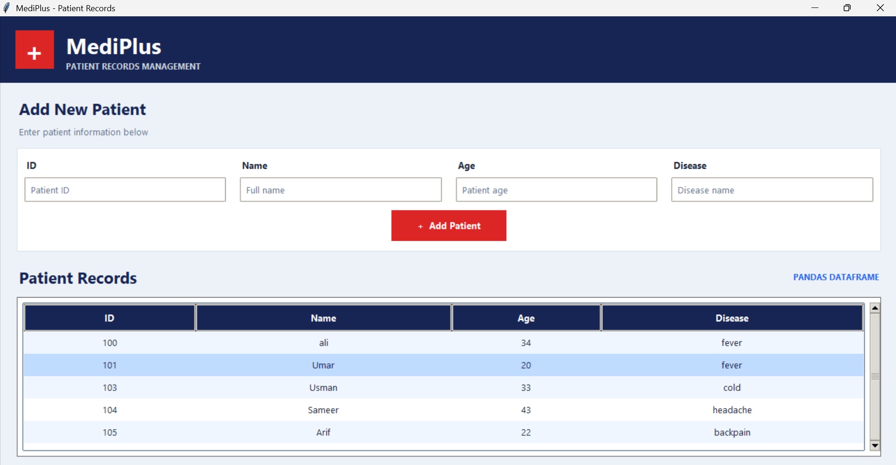

# MediPlus Algo 🏥

A desktop-based **Patient Records Management System** built with Python using a clean, modern medical-themed GUI.

## 📁 File Structure

| File / Folder | Description |
| :--- | :--- |
| `Images/pandas.png` | Visual brand assets for the application interface. |
| `gui.py` | UI layout, color theme definitions, and interactive forms. |
| `main.py` | Main entry script to initialize and launch the application. |
| `Medical_Data.py` | Backend database connection logic and parsing operations. |
| `Patients.csv` | Persistent dataset storage containing patient logs. |

## ✨ Core Features
- **Intuitive Desktop Dashboard**: Simple navigation layout tailored for medical clinic administration workflows.
- **Persistent Data Storage**: Automatic data parsing to flat-file CSV storage to ensure records are never lost.
- **Dynamic Data Rendering**: Integrates backend datasets with real-time UI display elements.

## 🛠️ Tech Stack
- **Python 3.x**
- **Tkinter / TTK** (Desktop Interface)
- **Pandas** (Data Manipulation)

## 📊 Visual Diagrams
Below are the conceptual layouts mapped for this application interface:

